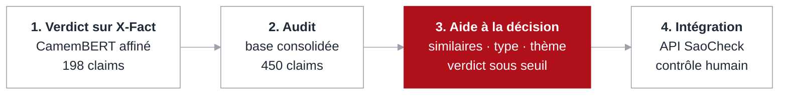
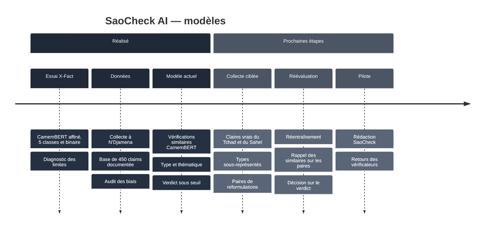

<div align="center">


<br>

[](#feuille-de-route)
[](#modèle-actuel)
[](#modèle-actuel)
[](#données)
[](#notebooks)
[](#licence)

**[Aperçu](#aperçu)** · **[Notebooks](#notebooks)** · **[Démarche](#démarche)** · **[Modèle](#modèle-actuel)** · **[Données](#données)** · **[Résultats](#résultats)** · **[Reproduire](#reproduire)** · **[Feuille de route](#feuille-de-route)**

</div>

---

## Aperçu

Ce dépôt contient la **recherche et les modèles d'IA** de [SaoCheck](https://saocheck.org), plateforme de fact-checking développée avec **WenakLabs** dans le cadre de l'**AI for Good Fellowship de Code for Africa**. La plateforme elle-même (portail, tableau de bord, API) se trouve dans [saocheck-platform](https://github.com/P-Adjinsala/saocheck-platform).

On y trouve le parcours complet : un premier essai de prédiction du verdict sur X-Fact, l'audit qui en a montré les limites, puis le modèle actuel, conçu comme une **aide à la décision**. L'IA retrouve les rumeurs déjà vérifiées et propose un type de manipulation et une thématique ; **le verdict reste toujours une décision humaine**.

<p align="center">
  
</p>

> [!IMPORTANT]
> Le modèle est intégré au MVP de la plateforme, validé sur un poste local. Ses sorties sont des **indices** pour l'équipe éditoriale : le type et la thématique sont indicatifs, et le verdict suggéré reste désactivé tant qu'il n'atteint pas les seuils de fiabilité.

---

## Notebooks

| # | Notebook | Contenu | Ouvrir |
| :---: | --- | --- | :---: |
| 1 | [`SaoCheck_AI_XFACT_Training.ipynb`](notebooks/SaoCheck_AI_XFACT_Training.ipynb) | Premier essai : CamemBERT affiné sur X-Fact (français) pour prédire le verdict, en 5 classes puis en binaire. Exploration, tokenisation, entraînement, matrices de confusion. | [](https://colab.research.google.com/github/P-Adjinsala/saocheck-ai/blob/main/notebooks/SaoCheck_AI_XFACT_Training.ipynb) |
| 2 | [`SaoCheck_AI_Model.ipynb`](notebooks/SaoCheck_AI_Model.ipynb) | Modèle actuel : base consolidée de 450 claims, audit des biais, vérifications similaires, classifieurs évalués par validation croisée groupée, décision de fiabilité, export pour l'API. | [](https://colab.research.google.com/github/P-Adjinsala/saocheck-ai/blob/main/notebooks/SaoCheck_AI_Model.ipynb) |

Le notebook 2 n'a pas besoin de GPU : le modèle de phrases est utilisé tel quel, sans réentraînement.

---

## Démarche



| Étape | Ce que nous avons appris |
| --- | --- |
| **1. Verdict sur X-Fact** | En 5 classes, le modèle prédisait « faux » pour presque tout (F1 macro 0,11). En binaire, il ne faisait guère mieux (F1 macro 0,44). Le pipeline technique fonctionne ; la tâche, telle que posée, ne marche pas. |
| **2. Audit de la base consolidée** | Un modèle de texte apprend le **style** des fact-checkers (le conditionnel, les noms de sources) plutôt que la véracité. Un claim seul ne contient pas la preuve. |
| **3. Aide à la décision** | Trois briques modestes, chacune évaluée honnêtement, plutôt qu'un juge automatique. |
| **4. Intégration** | Le modèle sert dans la veille, les investigations et la boîte de réception de la plateforme ; chaque analyse est enregistrée avec le nom du modèle. |

<details>
<summary><b>Et l'architecture LLM + RAG envisagée au départ ?</b></summary>
<br>

La première version de ce dépôt proposait une architecture cible combinant recherche documentaire (RAG), génération par un grand modèle de langage et validation humaine. Elle a été remplacée, pour le MVP, par l'approche en trois briques ci-dessous. La recherche de preuves dans une base documentaire régionale reste une piste pour la suite.
</details>

---

## Modèle actuel

<p align="center">
  
</p>

| Brique | Rôle | Méthode | État |
| --- | --- | --- | --- |
| **1. Vérifications similaires** | Retrouver une rumeur déjà vérifiée et afficher « Déjà vérifié ? » avec le verdict et la source | Similarité cosinus entre vecteurs de phrases | En service |
| **2. Type et thématique** | Proposer l'un des 7 types de manipulation et une thématique officielle | Régression logistique sur les vecteurs, classes rééquilibrées | En service, comme indice |
| **3. Verdict suggéré** | « Faux ou trompeur » ou « Vrai », sur un texte débarrassé du conditionnel | Régression logistique, seuils stricts | Désactivé (F1 0,63 < 0,75) |

**Modèle de phrases :** [`dangvantuan/sentence-camembert-base`](https://huggingface.co/dangvantuan/sentence-camembert-base), une version française de CamemBERT entraînée à comparer le sens de deux phrases. Il transforme chaque affirmation en un vecteur de 768 valeurs et rapproche deux formulations différentes d'une même rumeur.

**Repli lexical :** si le modèle ne peut pas être chargé (serveur modeste, pas d'accès à Hugging Face), une comparaison par fragments de 3 à 5 caractères prend le relais. Elle retrouve surtout les reprises presque mot pour mot, et l'interface le signale.

<details>
<summary><b>Garde-fous</b></summary>
<br>

- L'IA n'écrit jamais de verdict ; l'équipe décide et publie.
- Le verdict suggéré exige un F1 macro ≥ 0,75, un rappel ≥ 0,6 pour chaque classe **et** l'accord de l'administration.
- Le verdict est calculé sur un texte sans conditionnel, pour qu'il ne s'appuie pas sur la tournure des fact-checkers.
- Les classifieurs ne sont utilisés qu'avec le modèle de phrases qui a servi à les entraîner.
- Chaque entraînement produit un rapport (`rapport.md`) relu par l'équipe avant usage.
</details>

---

## Données

<p align="center">
  
</p>

La base de référence réunit **450 claims** : des vérifications du Tchad et du Sahel (SaoCheck, Hirondelle, PesaCheck, Africa Check, autres plateformes), des faits confirmés vrais et le sous-ensemble français de **X-Fact**. La collecte a été menée avec WenakLabs à N'Djamena en septembre 2026. **401 claims validés** servent à l'IA.

| Cible | Exemples | Classes |
| --- | ---: | --- |
| Type de manipulation | 400 | Affirmation ou chiffre (266), vidéo hors contexte (42), image hors contexte (23), média manipulé ou IA (22), faux document (20), arnaque (19), citation inventée (8) |
| Thématique | 188 | Politique et gouvernance, sécurité, économie, société (les thèmes seulement devinés par mots-clés sont écartés) |
| Verdict | 350 | Faux ou trompeur (278), vrai (72) |

<details>
<summary><b>Préparation des étiquettes</b></summary>
<br>

- Le type d'allégation, saisi en texte libre (une centaine de formulations), est ramené à 7 familles stables par des règles ordonnées.
- Les sujets sont ramenés aux thématiques officielles de SaoCheck.
- Dans X-Fact, « hors contexte » désigne en réalité des cas « difficiles à classer » : ils sont écartés du verdict.
- Les correspondances sont identiques dans le notebook et dans l'API (`app/ai/labels.py`).
</details>

> [!NOTE]
> Le classeur `Base_de_donnee_SaoCheck.AI.xlsx` n'est pas versionné dans ce dépôt. Il contient des extraits de messages réels, dont des numéros de téléphone tirés d'arnaques. Il est disponible auprès de l'équipe du projet.

---

## Résultats

<p align="center">
  
</p>

| Tête | Exemples | F1 macro | Classe majoritaire seule | Seuil | Décision |
| --- | ---: | ---: | ---: | ---: | --- |
| Type de manipulation | 400 | **0,59** | 0,11 | 0,50 | Indice |
| Thématique | 188 | **0,57** | 0,14 | 0,50 | Indice |
| Verdict | 350 | **0,63** | 0,44 | 0,75 | Désactivé |

> [!NOTE]
> Résultats obtenus avec sentence-CamemBERT, en validation croisée en 5 parties sur 401 claims validés, sans jamais séparer deux reformulations d'une même rumeur. La référence « classe majoritaire seule » correspond à un modèle qui prédirait toujours la classe la plus fréquente.

<details>
<summary><b>Pourquoi pas un simple classifieur de verdict ?</b></summary>
<br>

L'audit du notebook 2 le montre avec trois contrôles sur les 350 claims au verdict utilisable :

- **Le conditionnel suffit presque.** 134 des 278 claims faux ou trompeurs sont reformulés au conditionnel (« la vidéo *montrerait*… »), contre aucun des 72 vrais. La règle « conditionnel → faux » obtient un F1 macro de 0,58, presque autant qu'un modèle TF-IDF (0,61).
- **Les mots appris sont des tournures.** Les mots qui tirent le plus vers « faux » sont *montrerait*, *aurait*, *vidéo*, *image* : le style de la rédaction, pas le fond.
- **La généralisation hors source s'effondre.** Entraîné sans la source « faits confirmés » puis testé sur elle, le modèle n'en reconnaît aucun comme vrai (exactitude 0,00).

Un claim seul ne dit pas s'il est vrai ; seules les preuves le disent. D'où le choix de trois briques, et d'un verdict suggéré qui ne s'active qu'une fois la fiabilité démontrée.
</details>

---

## Reproduire

### Dans Google Colab

1. Ouvrez le notebook avec le badge **Open in Colab** ci-dessus.
2. **Exécution → Tout exécuter.** Les bibliothèques s'installent automatiquement.
3. Quand la fenêtre d'envoi s'ouvre, choisissez `Base_de_donnee_SaoCheck.AI.xlsx`.

Le notebook 2 tourne en quelques minutes sur le processeur ; le premier lancement télécharge le modèle CamemBERT (environ 450 Mo).

### En local

```bash
git clone https://github.com/P-Adjinsala/saocheck-ai.git
cd saocheck-ai
python -m venv .venv
source .venv/bin/activate          # Windows : .\.venv\Scripts\Activate.ps1
pip install -r requirements.txt
cp /chemin/vers/Base_de_donnee_SaoCheck.AI.xlsx data/
SAOCHECK_DATA="$PWD/data/Base_de_donnee_SaoCheck.AI.xlsx" jupyter lab notebooks/SaoCheck_AI_Model.ipynb
```

<details>
<summary><b>Réglages du notebook 2</b> (variables d'environnement)</summary>
<br>

| Variable | Par défaut | Rôle |
| --- | --- | --- |
| `SAOCHECK_DATA` | `Base_de_donnee_SaoCheck.AI.xlsx` | Chemin du classeur consolidé |
| `SAOCHECK_ENCODER` | `dangvantuan/sentence-camembert-base` | Modèle de phrases ; `hashing` force la comparaison lexicale |
| `SAOCHECK_OUTPUT` | `ai_models` | Dossier où sont écrits les fichiers exportés |
</details>

### Utiliser le modèle dans la plateforme

Le notebook 2 écrit dans `ai_models/` les trois fichiers attendus par l'API de [saocheck-platform](https://github.com/P-Adjinsala/saocheck-platform) :

| Fichier | Contenu |
| --- | --- |
| `classifiers.joblib` | Les trois têtes entraînées, leurs mesures et leur statut de fiabilité |
| `metrics.json` | Les mêmes mesures, lisibles sans Python |
| `rapport.md` | Le rapport d'entraînement à relire avant usage |

Copiez `classifiers.joblib` dans le dossier `AI_MODELS_DIR` de l'API, puis **Administration → Configuration IA → Recharger**. Sur le serveur, on peut aussi l'entraîner directement :

```bash
python -m scripts.import_reference_claims Base_de_donnee_SaoCheck.AI.xlsx
python -m scripts.train_ai_models
```

> [!CAUTION]
> Charger un fichier `joblib` exécute du code Python. N'utilisez qu'un `classifiers.joblib` produit par l'équipe, jamais un fichier reçu d'ailleurs, et ne le versionnez pas : le dossier `ai_models/` est ignoré par Git.

---

## Structure du dépôt

```text
saocheck-ai/
├── notebooks/
│   ├── SaoCheck_AI_XFACT_Training.ipynb   # 1. CamemBERT affiné sur X-Fact (5 classes, binaire)
│   └── SaoCheck_AI_Model.ipynb            # 2. Modèle actuel : audit, similaires, classifieurs, export
├── docs/
│   ├── SaoCheck_AI_Presentation_Modeles.docx     # note de présentation des modèles (FR)
│   ├── SaoCheck_AI_Presentation_Models_EN.docx   # model presentation brief (EN)
│   └── assets/                                   # figures de ce README
├── data/                                  # classeur consolidé (non versionné)
├── ai_models/                             # sorties du notebook 2 (non versionnées)
├── requirements.txt
├── .gitignore
└── README.md
```

---

## Feuille de route



---

## Principes

| Principe | Engagement |
| --- | --- |
| **Humain dans la boucle** | L'IA propose, l'équipe décide. Aucun verdict n'est posé automatiquement. |
| **Évaluation honnête** | Validation croisée sans fuite entre reformulations, comparaison à une référence naïve, seuils fixés avant de voir les résultats. |
| **Transparence** | Scores, limites et échecs documentés, y compris le premier essai sur X-Fact. |
| **Contexte local** | Données, sources et réalités informationnelles du Tchad et du Sahel. |

---

## Équipe et contexte

SaoCheck AI est développé par **Pantouin Adjinsala** ([P-Adjinsala](https://github.com/P-Adjinsala)), AI for Good Fellow de **Code for Africa**, avec **[WenakLabs](https://wenaklabs.org/)** et l'équipe éditoriale de SaoCheck au Tchad.

📧 pantouinadjinsala@gmail.com · 💼 [LinkedIn](https://www.linkedin.com/in/pantouin-adjinsala-2b1429207) · 🌐 [Portfolio](https://pantouinadjinsala.com)

## Licence

À définir selon les modalités du programme CfA AI for Good Fellowship.

> [!WARNING]
> SaoCheck AI est un outil d'aide à la vérification. Ses analyses automatiques sont des éléments d'aide à la décision : elles doivent être confrontées aux sources et validées par un fact-checker.

<div align="center">
<br>
<sub><b>SaoCheck AI</b> · Pour une information plus fiable, plus transparente et plus accessible au Tchad et au Sahel.</sub>
<br>
<sub>Détecter · Analyser · Vérifier · Publier</sub>
</div>
